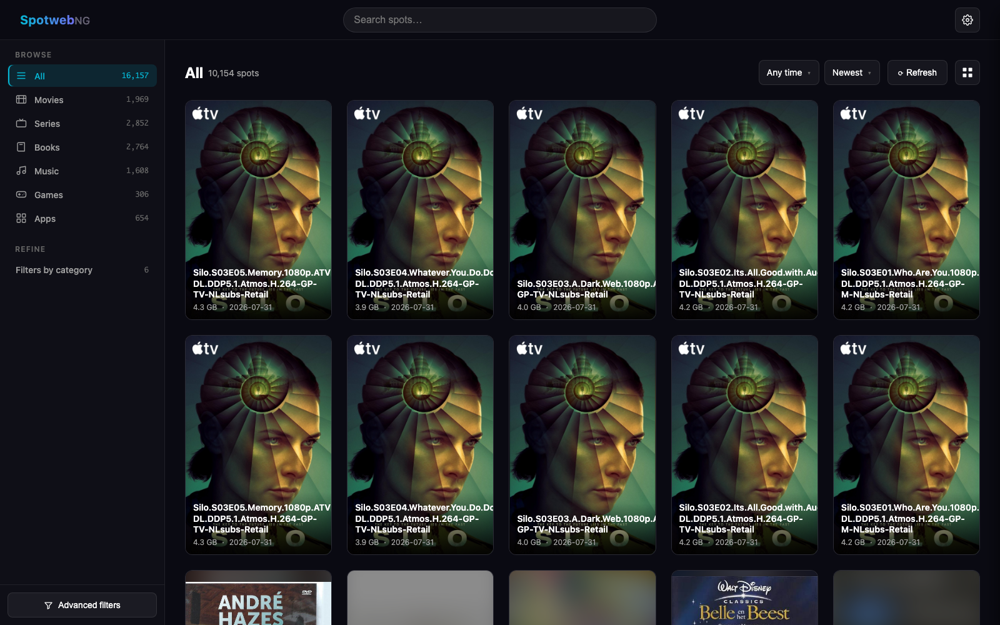
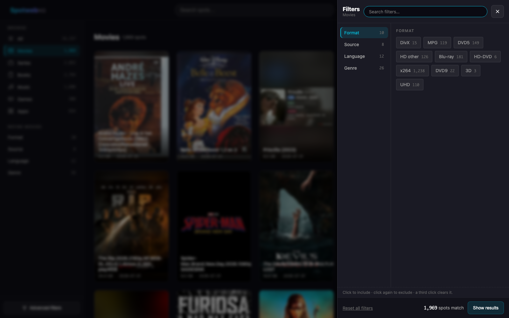

<div align="center">

# SpotwebNG

**A modern Spotweb.** Self-hosted Spotnet indexer for Usenet, with a Newznab API
for Radarr, Sonarr and Prowlarr — and a UI you'll actually want to browse.

[](https://github.com/cyrus109/SpotwebNG/actions)
[](https://www.python.org/)
[](#run-it)
[](LICENSE)



</div>

## What it is

Spotnet is a Usenet community that publishes signed "spots" — posts describing content
available on Usenet. [Spotweb](https://github.com/spotweb/spotweb) has indexed them since
2011 and still works, but it is PHP from another era.

**SpotwebNG is a ground-up rebuild** in Python: the same Spotnet retrieval engine and
category system, a Newznab API your existing tools already speak, and a browsing
experience built for how people actually look for things.

It is not a fork. The wire format, category tree and filter grammar were re-derived from
the Spotweb source so behaviour matches; everything else is new.

## Why you might want it

|  | Spotweb | SpotwebNG |
|---|---|---|
| Stack | PHP 7, jQuery | Python 3.11, FastAPI, async SQLAlchemy |
| Install | web server + PHP + database | `docker compose up -d` |
| Browsing | dense tables | poster grid with cover art, or a table if you prefer |
| Filtering | category tree | the same tree grammar, with **live counts on every option** |
| Accounts | full ACL system | admin / viewer roles, throttled login |
| API | Newznab | Newznab, per-client keys with last-used tracking |

## Screenshots



*Sub-filters are contextual: Movies get Format, Source, Language and Genre; Games get
Platform, Format and Genre. Every option shows how many spots it would leave.*

## Run it

```bash
git clone https://github.com/cyrus109/SpotwebNG.git
cd SpotwebNG
docker compose up -d --build
```

To update later: `docker compose pull && docker compose up -d` (CI publishes the image; or
`git pull && docker compose up -d --build` to build locally). Your data stays in the volume
and upgrades never re-read Usenet — see [docs/DEPLOY.md](docs/DEPLOY.md) for how schema
upgrades, safety backups and rollbacks work.

Open <http://localhost:7979>. The setup wizard asks for an administrator login first —
**complete it, because until you do the instance is open to anyone who can reach it** —
then your Usenet provider, picked from a built-in catalogue of 68 with host, port and TLS
filled in for you. The connection is tested before anything is saved.

Everything lives in one Docker volume: the database, cached cover art and assembled NZBs.

<details>
<summary>Without Docker</summary>

```bash
python -m venv .venv && .venv/bin/pip install -r requirements.txt
.venv/bin/uvicorn app.main:app --host 0.0.0.0 --port 7979
```

SQLite is the zero-config default; set `SPOTWEBNEXT_DATABASE_URL` to a
`postgresql+asyncpg://` URL to use Postgres instead.

</details>

## Connect your download tools

SpotwebNG speaks the **Newznab API**, which almost every Usenet tool already
understands. Get a key from **Settings → API access** (one per client, so you can
revoke one without breaking the rest), then point tools at:

```
http://your-host:7979/api
```

Worth knowing before you start: **SABnzbd and NZBGet are downloaders, not
searchers.** They fetch NZB files but do not query indexers. The search side is
handled by Prowlarr or the *arr apps, which then hand the NZB to your downloader.

### Indexer managers — configure once, share everywhere

| Tool | Where | What to enter |
|---|---|---|
| **Prowlarr** | Indexers → Add → **Generic Newznab** | URL `http://your-host:7979`, API path `/api`, your API key |
| **NZBHydra2** | Config → Indexers → Add → **Newznab** | Host `http://your-host:7979`, API key, then *Check caps* |

This is the recommended route: add SpotwebNG once in Prowlarr and it syncs to
Radarr, Sonarr, Lidarr and Readarr automatically.

### The *arr apps — add it directly

In **Settings → Indexers → Add → Newznab**:

| App | Categories to select | Search it uses |
|---|---|---|
| **Radarr** | 2000 Movies | `t=movie` with `imdbid` or a title |
| **Sonarr** | 5000 TV | `t=tvsearch` with season and episode |
| **Lidarr** | 3000 Music | `t=music` with artist and album |
| **Readarr** | 7000 Books | `t=book` with author and title |
| **Whisparr** | 6000 Erotica | `t=search` — see the note below |

Leave *Additional Parameters* empty. If a client reports "indexer does not
support this search", check that its category is present in
`http://your-host:7979/api?t=caps`.

**Adult content is hidden by default.** While *Settings → Display → Hide adult
content* is on, the 6000 range is not advertised in caps, is not returned by any
search, and its covers are not served — so Whisparr will find nothing until an
administrator turns the setting off. Only administrators can change it.

Mylar3 asks for comics (category 7030), which Spotnet does not file separately,
so it has nothing useful to match against.

### Downloaders — subscribe to a feed

The API returns a standard RSS 2.0 feed whose items carry an NZB `<enclosure>`,
so a downloader can grab new spots without any indexer app in between.

**SABnzbd** — Config → RSS → add a feed:

```
http://your-host:7979/api?t=search&cat=2040&apikey=YOUR_KEY
```

Set a filter (for example `Accept` on a title pattern), tick *Read the feed*, and
SABnzbd will download matching spots as they appear. Swap `cat=` for the
categories you want; `2040` is Movies/HD, `5040` is TV/HD, `3040` lossless music.

**NZBGet** has no built-in RSS reader — use Prowlarr or an *arr app in front of
it, or one of the community RSS extension scripts.

### Mobile and browser

- **nzb360** (Android) — add under *Indexers* as Newznab with the URL and key.
- **LunaSea** / **nzbUnity** — anywhere that accepts a Newznab indexer works.

### Check it yourself

```bash
curl "http://your-host:7979/api?t=caps"                                   # no key needed
curl "http://your-host:7979/api?t=search&q=ubuntu&apikey=YOUR_KEY"        # a search
curl -O "http://your-host:7979/api?t=get&id=123&apikey=YOUR_KEY"          # a real NZB
```

If `t=caps` answers but a client refuses, it is nearly always the API path: some
clients want the base URL, others the full `/api`.

## How it works

- **Retrieval** — reads spot headers from the `free.pt` newsgroup over NNTP in XOVER
  batches, unpacking the metadata Spotnet packs into the `From` header. The position
  bookmark is validated by message-id, so article renumbering on the server cannot make
  the indexer skip or replay a range.
- **Enrichment** — fetches each spot's full XML payload for its description, cover art and
  NZB segment list. Covers are cached and served locally.
- **Filtering** — implements Spotweb's `tree` grammar (`cat0_z0_a9`, `~` to exclude): OR
  within a dimension, AND across dimensions. All 283 Spotnet category codes are included
  under their real names.
- **Retention** — keep spots listed while dropping their heavy parts, or delete them
  outright. Without a policy an index grows forever.
- **Comments** — read-only. Comment headers are indexed from the comments newsgroup
  (*Settings → Index comments*; the group name is configurable, default `free.usenet`) and
  linked to their spot through their own message-id. The text of a comment loads the first
  time you open the spot. Comment text is untrusted: it is escaped, size-capped and shown as
  *unverified*, because Spotnet signatures are not checked yet.
- **Full history** — see below.

## Retrieving the full history

By default a first run only fetches the most recent articles. *First-run backfill* takes a
number and a unit: **articles** (20,000 by default) or **days** (for example, the last 30
days of spots). To index everything your Usenet provider still keeps — often
years of spots — either:

- turn on **Retrieve the server's full history** in *Settings → Retrieval & retention*, so
  the background loop does it automatically, or
- press **Full history** on the browse toolbar for a one-off run (admins only).

How it works: after fetching new spots, a second pass walks backwards from the oldest article
already scanned down to the server's oldest article, in 5,000-article chunks. The backfill
size is ignored while this is on. A bookmark (`spots_floor`) is saved after every chunk, so
it resumes after a restart and is validated by message-id like the forward bookmark.
Duplicates are skipped, so it is safe to turn on for an existing install.

Limit it by age: set *Limit full history to* N days and the walk ends at N days back
or at your provider's oldest article, whichever comes first (0 = no day limit). Raising the
limit later resumes the walk where it stopped.

Things to know:

- It can take hours and the database grows a lot. Use Postgres for very large histories.
- While it runs, the plain **Refresh** button answers "already running".
- Consider turning off *Background enrichment* first; otherwise covers and NZB references are
  fetched for every spot.
- If retention is set to delete old spots, the backfill skips spots older than the cutoff.

## Progress and backup

*Settings → Status & backup* shows what the retriever is doing right now with a progress bar
(also a small pill on the browse toolbar while it runs), the date of your provider's oldest
article, how far back the walk has reached, and where a day limit would stop it. The
provider's oldest date is learned during the first retrieval.

**Export database** downloads a gzip'd JSON Lines file with spots, comments and the
retrieval bookmarks, so a rebuilt install can **Import** it instead of re-reading Usenet.
Passwords, users, sessions and API keys are never exported. Import is additive: rows that
already exist are skipped, nothing is overwritten, and bookmarks are only taken when the
install has none. Cover images are not part of the file; spots that had one are fetched
again in the background. Both are admin-only.

## Signatures and posters

Spotnet spots are signed by their poster. From this version on SpotwebNG verifies those RSA
signatures (ported from Spotweb: trusted keys for key ids 2/3/4, self-signed keys for id 7,
plus the hashcash and user signature) and shows **✓ verified** or **⚠ signature failed** on the
spot page; comments are verified when their text is loaded. *Hide spots with a failed signature*
removes likely forgeries; unsigned spots are left alone. The verification rate is shown in
*Status & backup* — if it is near zero something is off, and the stored raw header lets a
background job re-check every spot locally without touching Usenet.

A verified self-signed poster has a stable **poster id** (a hash of their key). Admins can
**block** a poster from any spot page: their spots disappear from listings, search, counts and the
API, and a new nickname does not help. *Settings → Posters* lists blocked/trusted posters.
Spots stored by earlier versions have no raw header; a re-scan (*Reset retrieval position*) fills
it in place without touching covers or NZBs.

## Downloaded checkmarks

Spots whose NZB has been delivered — to a Newznab client such as Radarr or Sonarr, through the
**Download NZB** link, or with **Send** — get a green ✓ in the grid and table, and the spot page
shows when (and how often). The history is keyed by message-id, so it survives re-retrieving
or wiping the spots, and it is part of the database export. *Forget which spots were downloaded*
in *Status & backup* clears it.

## Sending spots to a downloader

*Settings → Download client* adds a **Send** button to every spot page (administrators
only). The app assembles the NZB itself, so the downloader never has to reach it:

- **SABnzbd** — the NZB is uploaded through SABnzbd's API (`mode=addfile`) with your
  category and priority. *Test connection* checks the URL and key and lists your
  categories. The API key is stored but never shown again; leave the field blank to keep it.
- **Black hole** — the NZB is written to a folder that your downloader watches. In Docker,
  mount that folder into the container (for example `- /srv/blackhole:/blackhole`) and enter
  the in-container path. Existing files are never overwritten.

Plain **Download NZB** is always available. The SABnzbd URL is called from the server, so
only point it at a service you trust.

## Availability check

Old Usenet posts lose articles. The spot page has an **Availability** badge with a *check* button:
the server assembles the spot's NZB and asks your news server (`STAT`, no article data is
downloaded) about a sample of up to 30 of its real articles — first, last and random ones — over
several connections. **✓ complete** means all sampled articles exist, **⚠ partial** that some are
missing (par2 may repair it), **✗ dead** that fewer than half exist. Results are kept for a day.
*Settings → Download client → Check availability before sending* can refuse dead spots (with a
"send anyway" override), only warn, or skip the check.

## Watchlists and notifications

*Watchlists* (a link in Settings) are saved searches — words in the title, a category, a size
range — that look at **new** spots after every retrieval (existing and merely old spots are
ignored) and either **notify** you or **send** the NZB to your downloader, applying the
availability check. Spots already downloaded, hidden adult content and blocked posters are skipped,
and each watch acts on a spot only once. A live preview shows how many spots match today.

*Settings → Notifications* supports a generic webhook (JSON), Discord, ntfy and Telegram. The
addresses and tokens are stored encrypted and never shown again, and request URLs are kept out of
the log. You can also be alerted when retrieval fails several times in a row (and when it recovers).

## Radarr and Sonarr

*Settings → Radarr & Sonarr* connects the apps' v3 API (address + API key; *Test connection* lists
your quality profiles and root folders). Spots that are already in your library get a 📚 badge,
and on a spot page administrators get **Add to Radarr** (movies) or **Add to Sonarr** (series): the
title is looked up by its IMDb/TVmaze id, added with your profile and root folder, and searched for
straight away. Spots are matched through the IMDb/TVmaze link in their website or description; a
background job fills that in for spots enriched earlier. Library lists are cached for ten minutes.

## Maintenance

*Settings → Status & backup* has housekeeping commands: apply retention now, remove orphan
comments and stale cached files, compact the database, reset the retrieval position (keeps
your spots, the next run starts from the backfill window again), delete all comments, or
delete everything and start from zero. The destructive ones ask you to type `DELETE`. Users,
settings and API keys are never touched.

## Security notes

- **CSRF:** every state-changing request carries a token derived from your session cookie
  (or, before signing in, from a random cookie handed out with the first page), so another
  website cannot submit forms or call endpoints as you — including creating the first
  administrator on an install that has none yet. The Newznab `/api` is read-only and uses API keys.
- Until the first administrator exists the instance is open to anyone who can reach it:
  create the administrator first.

## Configuration

Everything is configurable in the UI. Environment variables (prefix `SPOTWEBNEXT_`) exist
for deployments:

| Variable | Default | Purpose |
|---|---|---|
| `DATABASE_URL` | SQLite file | `postgresql+asyncpg://…` for Postgres |
| `SEED_DEMO_DATA` | `true` | demo spots on first boot so the UI is not empty |
| `APP_NAME` | `SpotwebNG` | shown in the UI and in Newznab caps |

`SPOTWEBNG_DATA` sets where cover art and NZBs are written; the Docker image points it at
the volume.

## Status

Working today: retrieval, enrichment, filtering, the Newznab API, accounts and retention.
Not yet: posting comments, signature verification, reports groups, saved filters, per-user watchlists.

Contributions welcome. Tests run with `pytest`; `ruff` and `mypy` gate every commit.

## Credits

The Spotnet wire format, category tree and filter semantics are derived from
[Spotweb](https://github.com/spotweb/spotweb) by the Spotweb contributors. This project
reimplements them and shares no code.

## License

Apache 2.0 — see [LICENSE](LICENSE).

<!--
Keywords: spotweb alternative, modern spotweb, spotnet indexer, usenet indexer,
newznab indexer, nzb indexer, self-hosted usenet, radarr sonarr prowlarr indexer,
spotweb docker, python usenet indexer, spotnet.
-->
